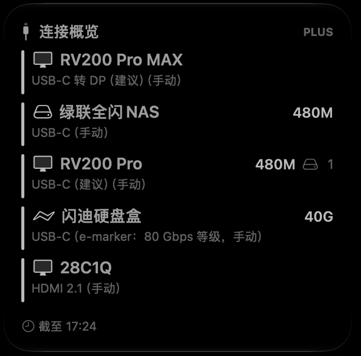
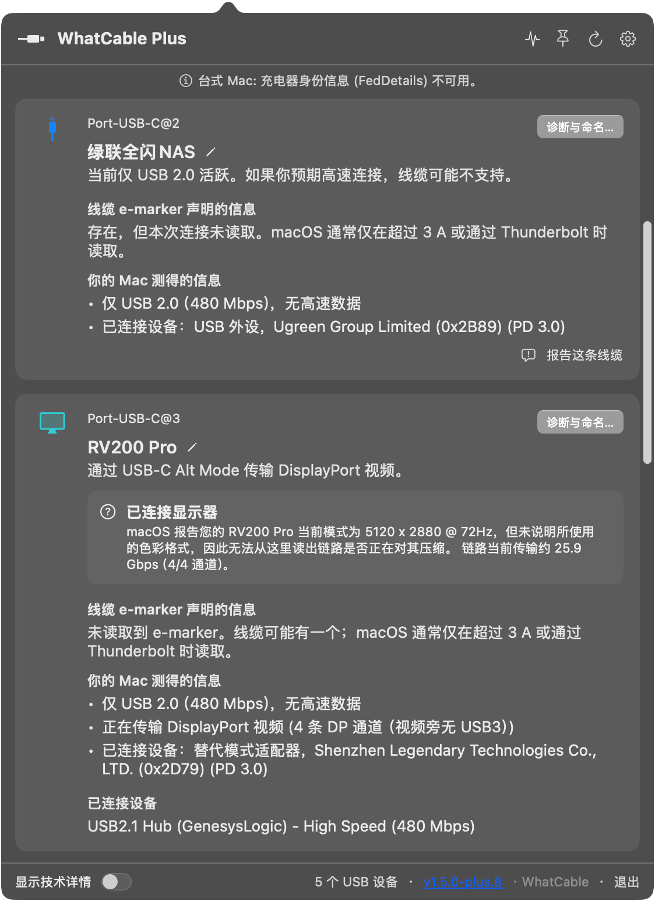
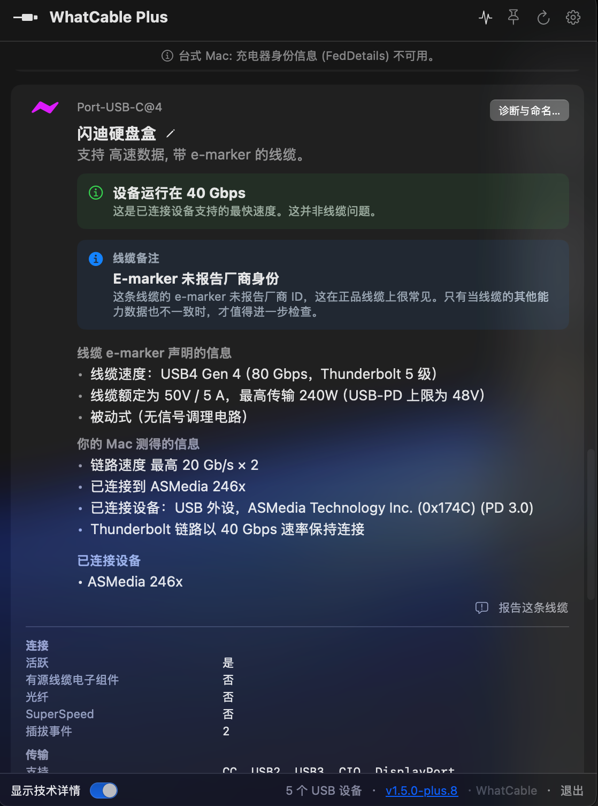
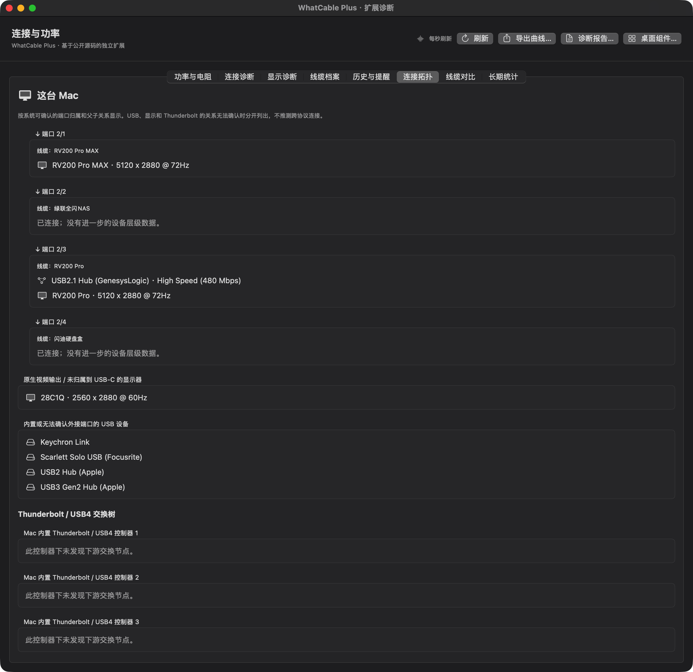

# 接口线缆助手 · Mac 版


适用于 Mac 的接口与线缆诊断工具，查看 USB-C、Thunderbolt / USB4 和原生 HDMI 连接、显示模式与功率记录。

> **来源与非官方声明**：本项目基于 [Darryl Morley 的 WhatCable](https://github.com/darrylmorley/whatcable) 公开 MIT 授权源码修改，上游基准提交为 `58e588ab45350cf9512ce40d4080fbbef3b94ad0`。这是独立维护的非官方分支，与原作者和 Apple 没有隶属或背书关系。新增扩展独立实现，不含私有 Pro 插件，不修改购买状态或许可验证。

## 下载与要求

在 [Releases](https://github.com/LeoLeung89/interface-cable-assistant/releases) 下载最新发布版。

- Apple Silicon Mac，macOS 15 或更新版本；本发布包仅含 arm64。
- 下载包采用本地 ad-hoc 签名，**尚未经过 Apple Developer ID 签名及公证**。macOS 可能阻止打开；也可按下文自行编译。不要关闭系统安全保护。
- 解压后将「接口线缆助手.app」放入应用程序目录。
- 这是独立维护的实验性版本，功能与不同机型的读数支持程度可能不同。

## 主要功能

- 连接诊断：充电、数据链路、显示模式与系统能确认的连接拓扑。
- 功率与记录：系统输入/电池放电、支持硬件上的端口 SMC 实测、十分钟曲线、CSV 与按小时统计。
- 线缆档案：名称、照片、长度、链接、备注；按接口与可观察连接对象记住名称，重启后恢复；不将同型号指纹当成唯一线缆身份。
- 连接名称与线缆说明：预填已识别显示器名称；线缆接法推测标为建议，e-marker 声明和当前速率分开。HDMI 名称与手动规格按接口保存。
- 桌面小组件：连接概览、功率概览，支持小、中、大尺寸；刷新由 macOS 调度，超过十五分钟的功率不作为当前值展示。
- 连接历史、可选异常提醒、显示模式基线、对比报告与终端仪表盘。

详细说明见 [功能与使用限制](docs/FEATURES.md)。

## 界面截图

以下截图展示连接概览、诊断与拓扑功能，界面中的 “WhatCable Plus” 是早期版本名称。

**连接概览**



**USB 与显示器诊断**



**线缆与速率诊断**



**连接拓扑**



## 读数含义

当前链路速率不是文件复制测速，也不是线材最大能力；系统功率不是插座电表读数。电阻估算针对整条充电路径，只有满足采样条件才显示，台式 Mac 通常无法使用。针脚页展示系统配置，不是逐针电压或导通测试。不能读取的数据保持未知。

## 数据与隐私

默认档案、照片与历史在本机 `~/Library/Application Support/WhatCableLab/` 保存，保留旧目录和内部标识是为了兼容早期本地版本。组件快照在本应用组件的系统容器中，未使用原作者的 App Group。系统通知需主动开启并授权。

本构建不自动更新，也不向原项目上传诊断数据。用户主动打开 GitHub、购买链接等外部网址时会连接相应网站。反馈问题前请检查日志、截图和报告中的设备信息。仓库中的界面截图包含示例设备及连接信息；本机线缆档案、照片和历史记录默认保存在本地。


## 更新与系统权限

发布包使用临时签名。更新或重新构建后，如果 macOS 提示原有授权不再适用，请按系统提示检查当前版本所需权限；具体影响取决于实际使用的功能。

## 从源码构建

需要完整 Xcode、Command Line Tools 和 Python 3。先由本人完成 Xcode 首次启动及许可确认。

```sh
bash scripts/build-lab.sh /tmp/interface-cable-assistant-build
```

若本机 CLT 与系统 SDK 不兼容，可明确使用完整 Xcode 的工具链：

```sh
WHATCABLE_LAB_SWIFT="$(xcrun --find swift)" \
WHATCABLE_LAB_DEVELOPER_DIR="$(xcode-select -p)" \
WHATCABLE_LAB_SDK="$(xcrun --show-sdk-path)" \
bash scripts/build-lab.sh /tmp/interface-cable-assistant-build
```

构建脚本生成原生 WidgetKit 工程，不需要 XcodeGen 或商业 Pro 插件。生成包采用 ad-hoc 签名，不含签名证书或凭据。

针对性测试：`bash scripts/test-lab.sh`。v1.0.1 修复版在维护者机器上通过 321 项针对性测试，并验证了应用及组件的构建和安装。该数字不代表运行了上游全部测试，也不代表覆盖所有硬件。

## 授权与致谢

- 原项目 Copyright (c) 2026 Darryl Morley。保留 [原始 LICENSE](LICENSE) 和 [第三方声明](THIRD_PARTY_NOTICES.md)。
- 本分支的独立修改按 MIT 提供；新增扩展目录另附 [MIT 许可](Sources/WhatCablePlugins/LICENSE)，不是上游私有开发仓库中的 Pro 目录。
- 更多来源及兼容标识说明见 [NOTICE.md](NOTICE.md)。
- “Mac 版”仅说明兼容平台，不表示 Apple 认证或官方产品。Mac、macOS 等商标属于 Apple，其他商标属于其各自权利人。

本软件按原许可“现状”提供，不保证诊断结论或硬件读数始终正确。


## v1.0.1 修复

- 登录启动只运行菜单栏和后台采集，不再自动打开设置及扩展诊断窗口。
- 按物理接口和可观察的连接对象保存自定义名称关联；相同连接重启后恢复，对象变化时不套用旧名称。
- 既有名称档案保持不变，首次运行可从同接口最后一次确认且与当前信息匹配的历史记录恢复关联。
- 新增跨重启恢复和损坏配置保护测试。
- 此构建使用 macOS 15 的场景启动控制接口，最低系统提高到 macOS 15；已同步重建安装包与源码包。

线缆 e-marker 不保证区分同型号的不同实体线缆。更换线材后请核对手动填写的规格。
